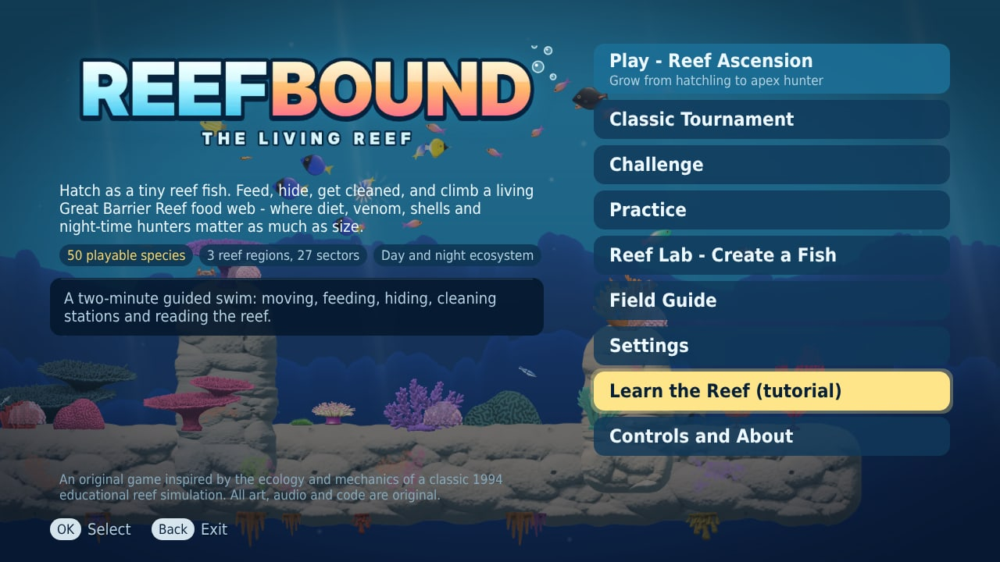
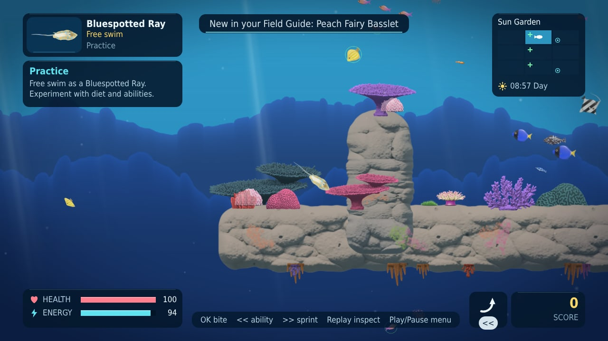
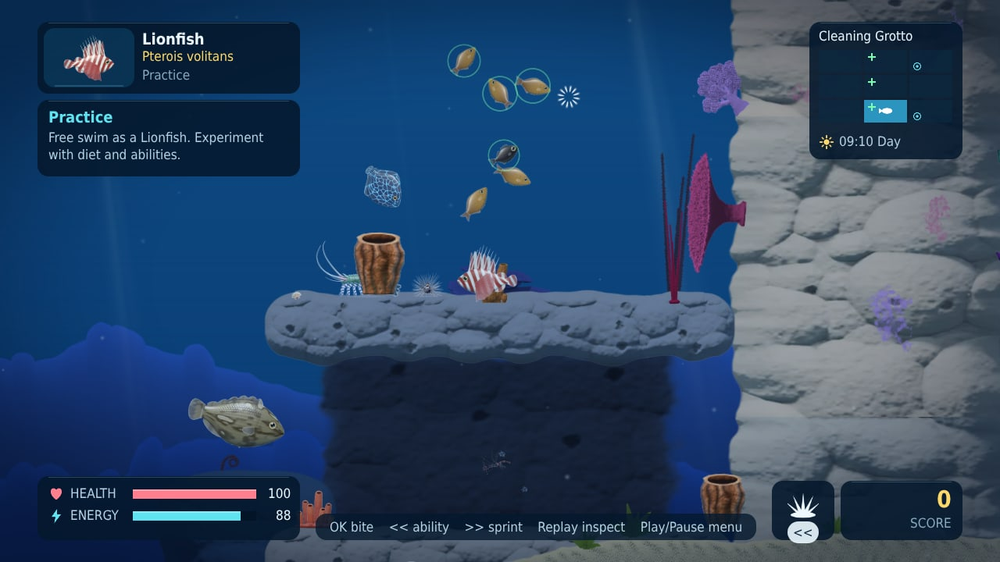
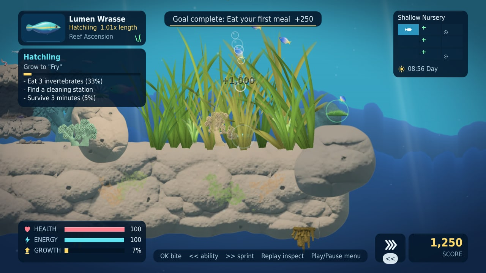
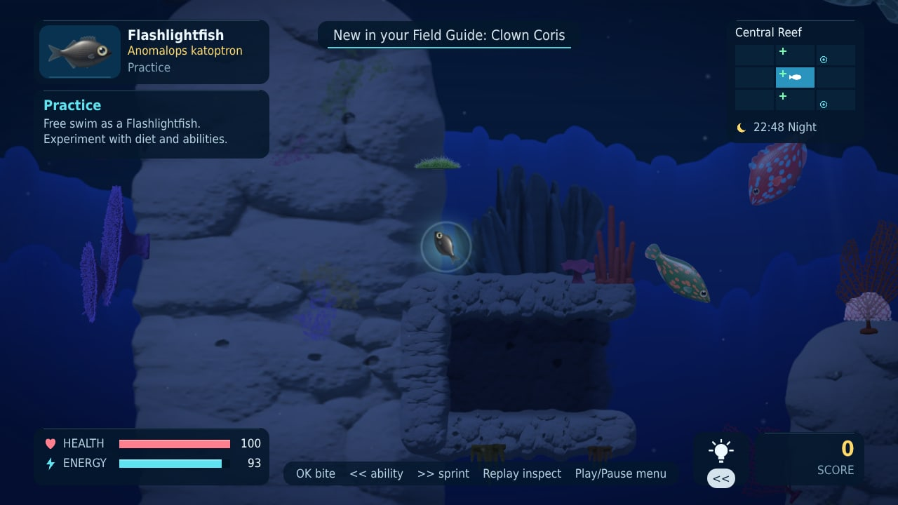
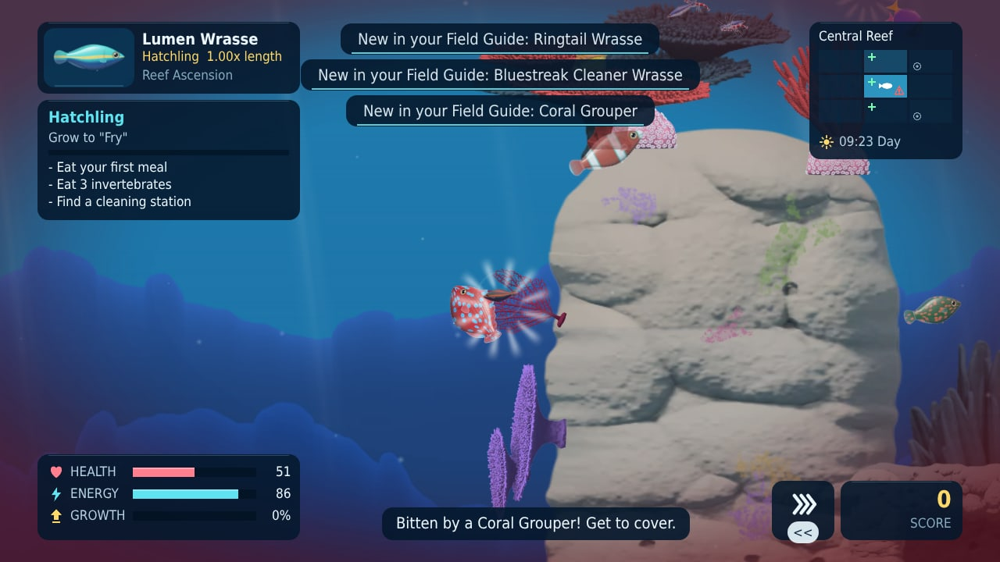
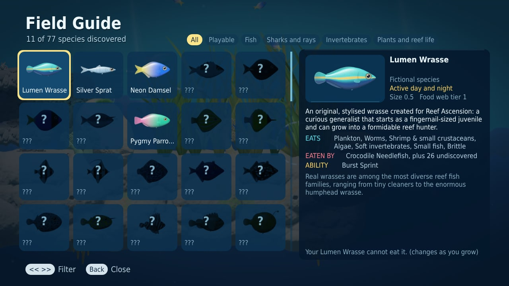
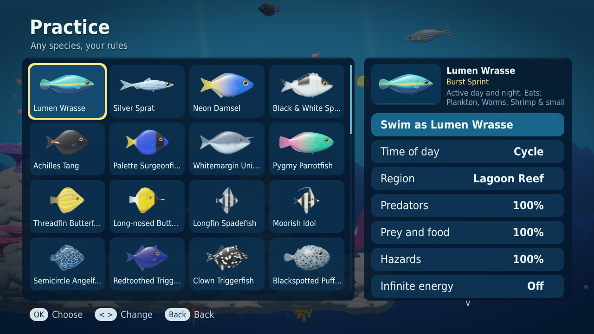
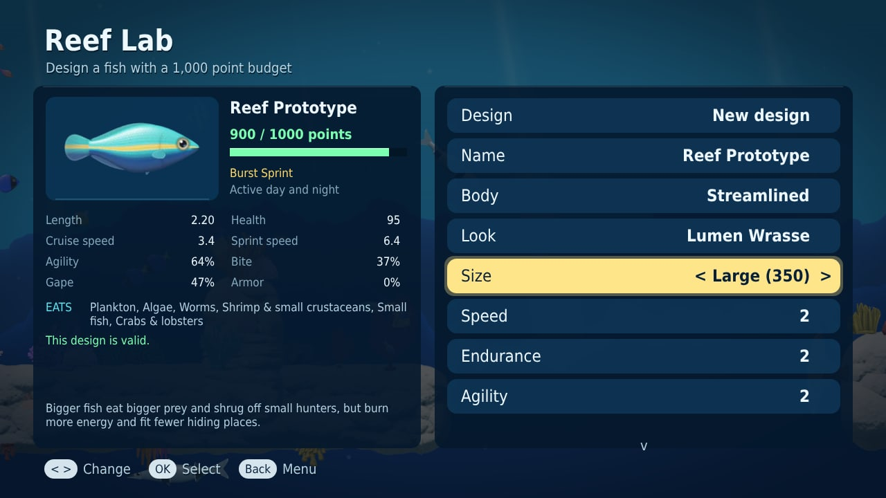

# REEFBOUND: The Living Reef — Roku channel

A Roku port of [REEFBOUND](https://github.com/JaredVogler2/REEFBOUND), the underwater food-web
survival game. You hatch as a tiny reef fish and feed, hide, get cleaned and grow your way up a
living Great Barrier Reef food web of 77 creatures, 50 of them playable.

The browser game is TypeScript + three.js. A Roku cannot run that, so this is a rewrite for the
platform: the simulation is ported to BrightScript, everything is drawn with the Roku 2D API
(`roScreen`), and the art was re-made for a TV as pre-rendered sprites.



| | |
|---|---|
|  |  |
|  |  |
|  |  |
|  |  |

All pictures in this repository are frames from the channel itself, running in a BrightScript
simulator at 1280x720.

> **Status.** The channel has been built, linted and played through in a simulator
> ([brs-engine](https://github.com/lvcabral/brs-engine)): the menus, every mode, the three
> regions, and soak tests with a dozen species. **It has not been run on a physical Roku in this
> environment.** See [Before publishing](#before-publishing) for what to check on a device.

## Play it

You need Node.js 20 or newer.

```bash
npm install
```

```bash
npm run package
```

That writes `dist/reefbound.zip` (about 2.8 MB; the Roku store limit for a channel is 4 MB and
the build fails if it is exceeded). To put it on a Roku:

1. Enable developer mode on the Roku: press Home three times, Up twice, then Right, Left, Right,
   Left, Right, and follow the prompts (it shows the device's address and asks for a password).
2. Open `http://<the Roku's address>` in a browser, log in as `rokudev`, choose
   `dist/reefbound.zip` and press **Install**.

To run it without a device, in the simulator:

```bash
npm run sim
```

Screenshots land in `tools/sim/out/`.

## Controls

| Remote | In the reef | In menus |
|---|---|---|
| D-pad | Swim | Move focus, change a value |
| OK | Bite: lock on to the best prey ahead, chase it and lunge | Select |
| Rewind `<<` | Use your ability (ink, spines, pulse, sprint burst...) | Field Guide filter |
| Fast-forward `>>` | Hold to sprint | Field Guide filter |
| Options `*` | Second ability (in the tutorial: next tip) | |
| Replay | Inspect: step through nearby creatures | |
| Play/Pause | Pause menu | |
| Back | Pause menu | Back / exit |

Rings around creatures: green = you can eat it, amber = risky (spines, toxins), red = dangerous
to you, grey = not food, pulsing red = it is hunting you.

## What is in the game

Everything from the web game's rules and content:

- **Reef Ascension** — grow from hatchling to apex through ten milestones, with goals, body
  upgrades and checkpoints.
- **Classic Tournament** — the 27-stage species ladder from Silver Sprat to Great White Shark.
- **Challenge** — four species, rising score targets, one life; random or daily line-ups.
- **Practice** — any of the 50 playable species, any region, time of day and difficulty sliders.
- **Reef Lab** — design a fish with a 1,000-point budget, test it, keep up to six designs.
- **Learn the Reef** — the guided tutorial.
- **Field Guide** — every creature, filled in as you discover it.
- Three regions (Lagoon Reef, Outer Wall & Bluewater, Twilight Wreck & Caverns) of nine sectors
  each, a day/night cycle with day, night and twilight species, cleaning stations, shelters that
  only fit small bodies, venom, spines, shells, schooling, ambush hunters and eleven abilities.

Progress (checkpoints, discoveries, scores, designs, settings) is saved in the Roku registry.

### Differences from the web game

| Web | Roku | Why |
|---|---|---|
| Mouse / keyboard / touch steering, click prey to chase | D-pad steering; **OK** locks on to the best prey ahead and chases it; **Replay** inspects | A remote has no pointer |
| Real-time 3D (three.js) | Pre-rendered sprites on the 2D API | See [Graphics](#graphics) |
| 60 Hz simulation, every creature every step | 30 Hz ticks; creatures near the camera run fully, distant ones coarsely | BrightScript is an interpreter; see [docs/ARCHITECTURE.md](docs/ARCHITECTURE.md) |
| A* path-finding for hunters | Steer-around-obstacles only | Cost; hunters still chase, search and give up |
| The camera stays inside one sector | The camera frames one sector but may look past its edges (sky above the top row, sand below the seabed) | Keeps the fish out from under the HUD in the corners |
| Reef Lab: free colours and patterns, typed names | Looks borrowed from an existing species of the same body plan, names from a list | Sprites are pre-rendered; a remote is a poor keyboard |
| Web Audio synthesis, adaptive music | 36 pre-rendered effects and two music loops | Roku plays files, it does not synthesise |
| Photo mode, key rebinding, HUD scale, high-contrast and reduced-motion options | Not included | |
| Eating heals other animals but not the player | Eating restores a little of the player's health too (30 % of the meal's energy) | The game's design document specifies it |

The numbers that define the game (species, diets, food web, balance, regions, goals, upgrades)
are not retyped: `tools/export-data` reads them out of the REEFBOUND source and writes the JSON
the channel loads.

## Graphics

The brief was graphics clearly better than the browser game's that still run on a Roku. A Roku
cannot do real-time lighting, so the lighting is done ahead of time:

- **Every sprite is rendered offline** by a small CPU "pixel shader" renderer in `tools/art`
  (nothing downloaded, nothing AI-generated): volumetric shading under one shared light rig —
  warm key light from above, blue ambient, cool rim light — so fish, corals and rock sit in the
  same water.
- **Creatures are rigs, not flipbooks.** A fish is a few parts (body strips, tail, pectoral fin)
  that the channel swings, squashes and waves in time with its swimming; an anemone's tentacles
  sway, a jellyfish pulses, a crab's legs step. 77 creatures, about 300 parts.
- **Rock is a height field** rendered with cast shadows and ambient occlusion, as three-slice
  pieces (cap, tiling middle, cap) that dress the reef's collision shapes exactly.
- **The reef is composed, not painted.** `tools/art/scene.mjs` lays out each region from a kit of
  about 80 pieces (corals, sea fans, sponges, seagrass, rock, timber), nearly all of them grey so
  the channel can tint them: authored props, seeded scatter on every surface, growth on walls
  and under ledges, encrusting colour, hazy growth behind the play plane. Three regions and six
  biomes cost one set of textures.
- **Light is a colour multiply.** Each piece is tinted by biome, depth (red fades first) and time
  of day, which gives day, dusk, night and three depths from the same sprites. On top: a parallax
  backdrop, light shafts, the waterline and sky, drifting particles, a soft vignette.

Budget: four WebP atlases, 1.5 MB on disk, about 41 MB as textures, plus half and quarter size
copies the channel makes at load time so that small sprites are drawn from a copy near their
on-screen size. **Low detail** keeps the creature and scenery sheets at half resolution — a
quarter of the memory — and trims decoration. *Auto* picks it on devices that report little
memory, and sheds decoration by itself if the frame rate stays low.

More in [docs/ART_PIPELINE.md](docs/ART_PIPELINE.md).

## Project layout

```
channel/                 the Roku channel (this folder is what gets zipped)
  manifest
  source/*.brs           about 11,800 lines of BrightScript
  assets/                sprite atlases (WebP) + sprites.json        <- built by tools/art
  data/                  species, balance, food web, regions, scenes <- built by tools/export-data, tools/art
  sounds/                effects (WAV) and music (MP3)               <- built by tools/audio
  images/                splash screens and home-screen icons        <- built by tools/art/make-brand.mjs
tools/
  export-data/           reads the web game's source, writes channel/data
  art/                   offline renderer, sprite generators, atlas packer, scene composer
  audio/                 audio synthesis (Python + numpy, ffmpeg for MP3)
  sim/                   simulator harness and test scripts
  build.mjs              packages channel/ into dist/reefbound.zip
docs/                    architecture, art pipeline, porting notes, screenshots
```

## Building the assets

The built assets are committed, so `npm run package` is all a normal build needs. To regenerate:

| What | Command | Needs |
|---|---|---|
| Game data | `REEFBOUND_DIR=/path/to/REEFBOUND npm run export:data` | A checkout of the web game with `npm ci` done |
| Sprites, atlases, scenes | `npm run art` | A few minutes of CPU; renders are cached in `tools/art/.cache` |
| Splash and icons | `npm run brand` | |
| Audio | `npm run audio` | Python 3 with numpy, and ffmpeg |

`node tools/art/preview.mjs tools/art/<module>.mjs` writes a review sheet for any sprite module,
and `node tools/art/scene-preview.mjs reef --sector=4` draws a composed scene offline.

## Testing

```bash
npm test
```

runs the BrighterScript checker, packages the channel and runs a smoke test in the simulator
(boot, start a run, swim, bite, pause). The simulator runs inside headless Chromium through
[Playwright](https://playwright.dev), which is not in `package.json`; if `require('playwright')`
does not resolve on your machine, add it with `npm i -D playwright` and
`npx playwright install chromium`.

More scripts are in `tools/sim/scripts`, for example a soak test that plays busily and badly for
a while:

```bash
node tools/sim/run.mjs --script=tools/sim/scripts/soak.mjs --args=mode=practice,species=cuttlefish,region=wreck,time=night
```

`--args` are launch parameters (the channel's `Main(args)`): `mode` (`ascension`, `tutorial`,
`tournament`, `challenge`, `practice`), `species`, `region`, `time`, `detail` (`high`/`low`), and
`test` (`upgrade`, `death`, `stage`, `apex`, `hurt`, `starve`, `night`, `clean`) to force
situations that take a while to reach by playing. A normal launch has none of these.

The simulator re-colours a whole texture in JavaScript whenever the tint changes, which a real
Roku does per draw on the GPU; the harness patches that one code path so scenes render at a
usable speed (see the comment in `tools/sim/run.mjs`). Either way, timing in the simulator says
little about a real device.

## Before publishing

Things that can only be settled on hardware:

- **Frame rate** on a low-end player (Roku Express class). The design target is 30 fps there and
  60 on faster players. The simulation is budgeted for it (see the architecture notes); drawing
  cost on a real GPU is unmeasured.
- **Texture memory** at High detail (about 54 MB with the reduced copies). Low detail exists for
  this; confirm which devices Auto should put in it.
- **Mirrored sprites, rotation and colour tinting.** These are documented behaviour of the 2D
  API and the channel probes them at start-up (`GfxProbe`). Without rotation it draws parts
  unrotated; it has no substitute for mirroring or tinting, so a device lacking either would
  show wrong art.
- **Sound mix.** Effect volumes were set by measurement, not by ear.
- **WebP atlases** need Roku OS 9.4 or newer.

## Credits

Game design, rules and content: REEFBOUND. This port's code, sprites, scenery, interface art and
audio were made for it; nothing is taken from other games or asset packs. The wordmark is set in
[Inter](https://rsms.me/inter/) (SIL Open Font License). Development tools: BrighterScript,
brs-engine, sharp, @napi-rs/canvas, fflate.

REEFBOUND is an original game inspired by the ecology and mechanics of a classic 1994 educational
reef simulation. The Lumen Wrasse is a fictional species; real fish do not grow this fast.
